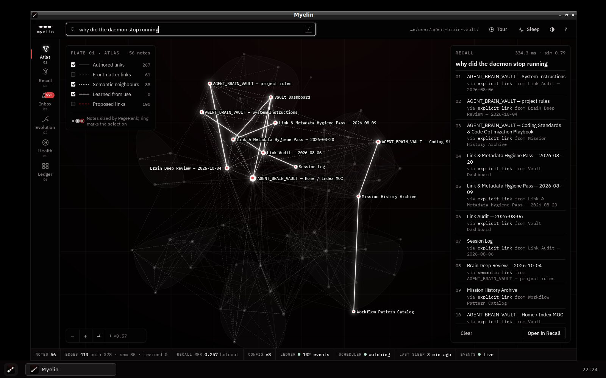
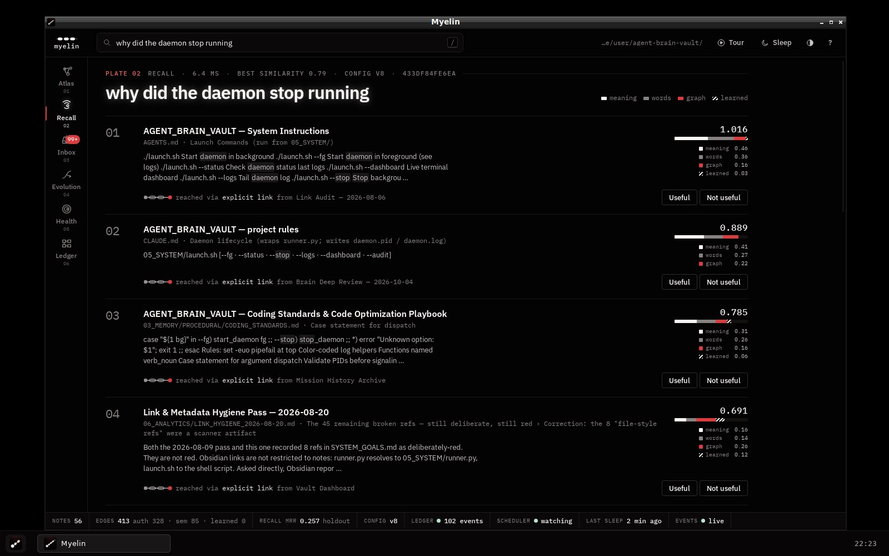
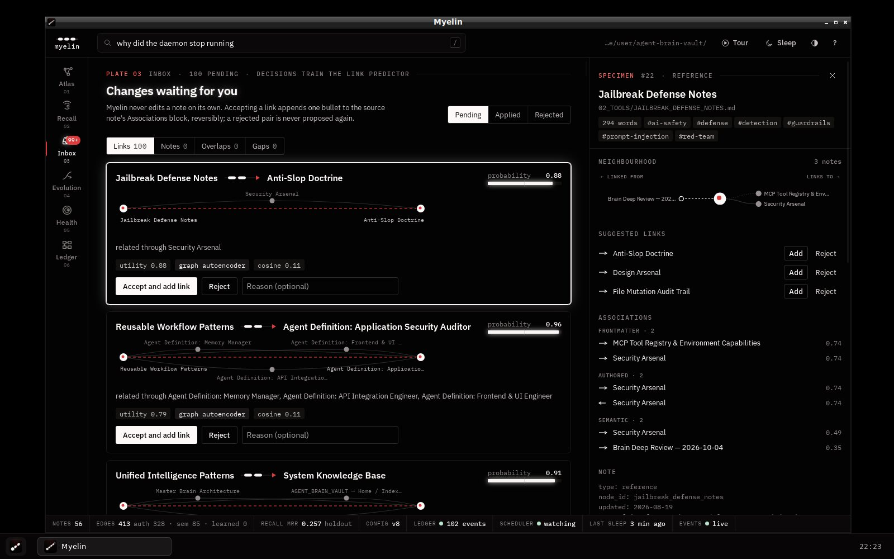
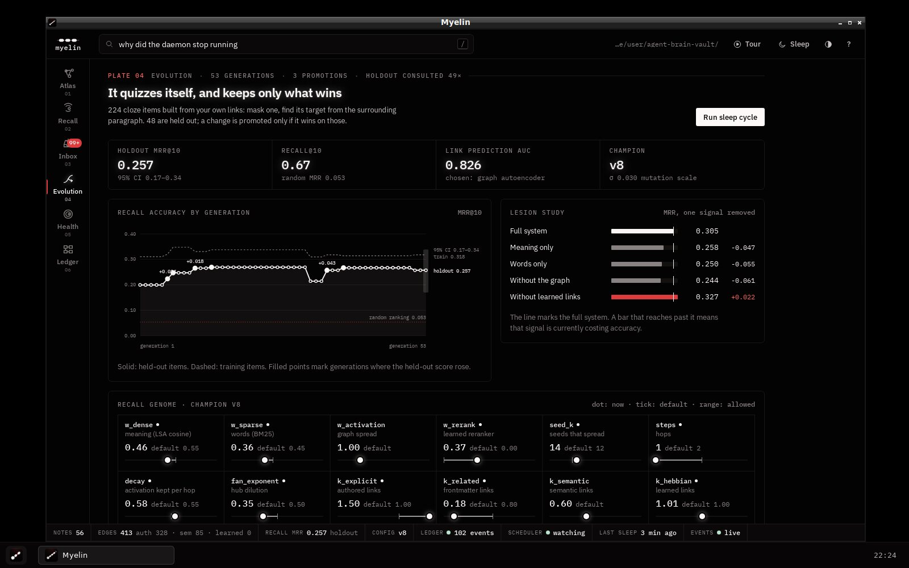

# Myelin

A self-reinforcing knowledge brain over a markdown vault. It indexes your notes, finds
the right one from a vague question or a half-written paragraph, explains why it chose
it, and measures its own accuracy on a benchmark it builds from your links. A sleep
cycle trains its models and tunes its own recall settings, and a change is kept only
if it beats the old settings on questions it was not tuned on.

Named for the sheath that wraps nerve fibres: paths that carry signal often get
insulated and conduct faster. Notes you use together get linked more strongly here.

| | |
|---|---|
|  |  |
|  |  |

Screenshots are of the desktop app on Linux (WebKitGTK window, Openbox title bar, the
panel launcher installed by `myelin install-app`).

## Quick start

```bash
pip install numpy pyyaml            # required
pip install mcp anthropic           # optional: Claude Code tools, Claude answers

cd /path/to/vault
python3 -m myelin init              # writes myelin.toml; edit the scope first
python3 -m myelin ingest            # index (5 s for ~1,200 passages)
python3 -m myelin sleep             # train, evaluate, evolve, publish the self-model
python3 -m myelin app               # open the desktop app
```

Run from a checkout without installing: `PYTHONPATH=/path/to/myelin python3 -m myelin …`.
Or `pip install -e myelin` to get a `myelin` command.

`myelin.toml` sits at the vault root and sets which folders are indexed; `init`
writes a starting one for you to edit.

## Desktop app

`myelin app` opens Myelin in its own window. It is not a web page: there is no browser,
no address, and no port. The window is the operating system's own web view, driven by
[pywebview](https://pywebview.flowrl.com/) (WebKitGTK on Linux, WKWebView on macOS,
WebView2 on Windows), and the interface talks to the brain in the same process
through pywebview's bridge. Live events (sleep progress, ledger entries from other
processes) are pushed into the window from Python. The app also runs the scheduler,
unless a `myelin daemon` already owns the vault.

The shortest way onto your desktop, from the vault folder, with the system Python:

```bash
python3 myelin/install_desktop.py           # Windows: py myelin\install_desktop.py
```

It gives Myelin a private Python environment (nothing goes into the system Python),
installs pywebview, numpy and PyYAML there, checks that a window can open, and installs
the menu entry and a desktop icon that start that environment's Python. If the system
web view is missing (Linux), it names the package to install and stops.

By hand, in an environment you manage yourself:

```bash
pip install pywebview                       # or: pip install -e 'myelin[app]'
python3 -m myelin app --check               # says what is missing on this machine, if anything
python3 -m myelin install-app               # shows what it would install
python3 -m myelin install-app --apply       # add Myelin to the applications menu, with its icon
python3 -m myelin install-app --apply --desktop   # and a desktop shortcut
```

| | Window | Launcher written by `install-app --apply` |
|---|---|---|
| Linux | WebKitGTK through PyGObject. Debian/Ubuntu: `sudo apt install python3-gi gir1.2-gtk-3.0 gir1.2-webkit2-4.1`; Fedora: `sudo dnf install python3-gobject webkit2gtk4.1`; Arch: `sudo pacman -S --needed python-gobject webkit2gtk-4.1`. Or Qt via `pip install 'pywebview[qt]'` | `~/.local/share/applications/myelin.desktop`, icons in the hicolor theme (16–512 px and SVG) |
| macOS | WKWebView through pyobjc (installed with pywebview) | `~/Applications/Myelin.app` with `myelin.icns` |
| Windows | Edge WebView2 (ships with Windows 11) | Start menu shortcut with `myelin.ico`, using `pythonw.exe` so no console opens |

The launcher runs the interpreter that ran `install-app` (or `--python PATH`) and
refuses to install if that interpreter cannot open the window. On Linux the GTK
bindings belong to the system Python, so install the launcher with that one, e.g.
`/usr/bin/python3 -m myelin install-app --apply`. The window identifies itself as
`Myelin`, so docks group it under the launcher's icon. A crash at start-up leaves its
traceback in `.myelin/app/last-error.txt`, since a launcher has no terminal. Under
NVIDIA's proprietary driver the app sets `WEBKIT_DISABLE_DMABUF_RENDERER=1`, because
WebKitGTK's DMA-BUF renderer leaves the window blank on many such systems; a value you
set yourself is kept. (Not tested here: this container has no NVIDIA driver.)

On the first opening the window comes up before the vault has been read. The Atlas
says so and draws itself when indexing finishes; the guided tour waits for the first
sleep, which builds the self-quiz and takes its first measurements, and shows its
progress meanwhile.

Verified here on Linux: the launcher installs and validates with
`desktop-file-validate`, opens the window from a panel click, and the window carries
the class and icon the dock needs. The macOS and Windows launchers are generated and
unit-tested but were not run on those systems.

`myelin app --browser` serves the same interface at `localhost:7317` for machines with
no native web view; `myelin serve` does the same for remote or headless use.

## Commands

| Command | What it does |
|---|---|
| `recall "question" [--snippets]` | ranked notes with score breakdown and the link that led to each |
| `sleep [--generations N]` | ingest, Hebbian consolidation, structure, link prediction, reranker, evolution, review proposals, self-model |
| `quiz` | score the current recall config on the self-quiz, with ablations |
| `evolve [--generations N]` / `evolve --rollback` | run evolution only, or restore the previous champion |
| `proposals [--kind link\|note\|merge\|gap]` | the inbox |
| `accept ID` / `reject ID [--reason]` / `revert ID` | decide; `revert` undoes an applied link if the note is unchanged since |
| `feedback RECALL_ID NOTE --useful` | label a result |
| `critique FILE\|- [--strict]` | authenticity check for prose; `--strict` exits 1 on a high-severity finding |
| `self` | print the self-model |
| `verify` | verify the hash-chained ledger |
| `app [--tour] [--check] [--browser]` | the desktop app; `--tour` plays the guided tour on opening |
| `install-app [--apply] [--desktop] [--python PATH]` | add the app to the applications menu with its icon (dry run by default) |
| `serve [--no-daemon]` | the same UI over HTTP on localhost, plus the API; also watches the vault and sleeps on schedule |
| `snapshot OUT --query "…"` | a read-only, server-free copy of the UI and brain data (note text left out unless `--with-content`) |
| `daemon [--once]` | watcher and scheduler without the UI |
| `mcp` | MCP server on stdio |
| `claude install [--apply]` | wire the MCP server and hooks into Claude Code (dry run by default) |
| `ask "question"` | Claude answers using the brain as tools, with citations (needs an API key) |
| `agent` | Claude reviews pending link proposals and records a verdict for you |

## How it thinks

**Recall.** A query is matched two ways: BM25 over passages (exact words) and cosine
similarity in an LSA space learned from your vault (related words). The best matches
seed *spreading activation*: each hop passes on part of its activation along typed,
weighted links, divided by the degree of both ends so hub notes cannot drown
everything. Results carry the seed and link kind that delivered them. A learned
reranker adds a score once it has earned a weight.

**Edges.** Four kinds: authored links, frontmatter links, semantic neighbours (from
the LSA space), and Hebbian links learned from use. Spreading along backlinks is its
own parameter; on AGENT_BRAIN_VAULT it measured as harmful, so its default is zero.

**The self-quiz.** Every authored link is a fact about what you found relevant. A
cloze item masks one link in its paragraph and asks recall to find the target. The
source note is excluded and the link itself is removed from the graph for that item,
so the system cannot answer by looking up the link it is being tested on, and every
other link to the same target in that paragraph is masked too. Items split into train
and holdout by a hash of their paths.

**Evolution.** Each sleep, the current recall settings are mutated several times, and
one gene is also probed at the ends of its range (cycling through the genome, so a
signal can be switched off entirely even after the mutation step has shrunk). The best
challenger on train is tested once on holdout and promoted only if it wins by a margin,
does not lose recall@10, and a paired sign-flip test on the per-item scores puts the
gain below a 5% chance of being noise. Every generation is a ledger event with the
exact parameter diff and the p-value. `evolve --rollback` undoes the last promotion.

**Neural models.** A small reverse-mode autograd engine (numpy, gradient-checked in
the tests) trains two models. A graph autoencoder (two GCN layers, MLP decoder with
neighbourhood features) predicts missing links; it is compared on held-out links
against Adamic–Adar and cosine similarity, and the best on validation is used. Its
training negatives avoid only training links, so it learns nothing about the held-out
ones that the baselines do not know. Test AUC is reported twice: against random
non-links, and against non-links two hops away, which share a neighbour and are the
case a link suggestion has to get right. The reranker is an ensemble of five small
MLPs trained on preference pairs (notes you marked useful, notes Claude Code read after
a recall, quiz answers versus the notes ranked above them). A newly trained one goes
live only if it does not lower recall on the train items; weights are versioned, so
the one it would replace survives.

**Proposals.** Link suggestions, near-duplicates, and repeated unanswered questions
land in the inbox. Accepting a link appends one bullet inside an `## Associations`
block in the source note, atomically, with before/after hashes in the ledger.
Rejected pairs become hard negatives and are never proposed again. Notes listed as
`protected` (generated by other programs) are never edited.

**Self-model.** Topics (Louvain communities, named by distinctive words), accuracy
with a bootstrap interval, ablations showing what each signal contributes, link
prediction scores, calibration against your decisions, unanswered questions, health,
and ledger integrity. Written to `.myelin/self_model.json` and, if `report_note` is
set, to a note in the vault.

## Claude Code

`myelin claude install` prints the changes; `--apply` writes them.

- **MCP server** `myelin` with nine tools: `recall`, `read_note`, `neighbors`,
  `suggest_links`, `propose_link`, `propose_note`, `critique`, `feedback`,
  `brain_status`. Writes only stage proposals.
- **Hooks.** `UserPromptSubmit` adds up to three matching notes to Claude's context,
  only when the best match clears `inject_min_score` and the prompt has four or more
  words. `PostToolUse(Read)` records which vault notes were read, which becomes
  implicit feedback and Hebbian links. `Stop` re-ingests and consolidates. Hooks never
  print errors and always exit 0.
- **Authenticity gate.** `propose_note` runs `critique` first. A draft with a
  high-severity default pattern, or a score of 40 or more, comes back to the agent with
  the findings and fixes instead of being staged.

## The authenticity gate

`critique` applies ten rules taken from the vault's ANTI_SLOP_DOCTRINE (marketing
openers, the "not just X, it's Y" frame, answered rhetorical questions, summary
closers, model-favourite vocabulary, filler, unquantified superlatives, vague
intensity claims, chat residue, adjective triads), each with a repetition threshold.
It then compares twelve style features against a baseline computed from your
hand-written notes and reports any feature more than two standard deviations away.
Em-dashes are not penalised by rule because this vault's author uses them; they count
only if a text uses them far more or less than you do.

It cannot tell who wrote a text. It reports whether choices were made, and which ones
were not.

## Configuration

`myelin.toml`, every key optional:

```toml
[vault]
include = ["**/*.md"]
exclude_dirs = [".git", ".obsidian", "node_modules"]
exclude_files = []
protected = ["*/GENERATED_REPORT.md"]   # read, never written
report_note = "MYELIN_SELF_MODEL.md"    # publish the self-model in the vault
inbox_dir = "inbox"                     # where accepted agent notes are written

[encoder]
kind = "lsa"            # or "command"
dim = 128
command = []            # e.g. ["python3", "embed.py"]: JSON {"texts": [...]} in, {"vectors": [...]} out

[hooks]
inject_context = true
inject_min_score = 0.55

[agent]
model = "claude-opus-5-5"
budget_usd = 2.0        # hard stop per call

[daemon]
sleep_interval_minutes = 360
```

Pin recall parameters under `[params]` to stop evolution from changing them.
State lives in `.myelin/` (SQLite, weights, ledger head); set `MYELIN_STATE_DIR` to
move it.

## Security

The desktop app opens no socket. Its page is one bundled document with a content
policy of `default-src 'none'` and `connect-src 'none'`, so nothing inside the window
can reach a network or load outside content; links open in the system browser. The
bridge exposes two methods to the page, `call` (the same handlers as the HTTP API) and
`subscribe`.

The server binds 127.0.0.1. Every API call needs a random per-process token that only
the served page receives; the `Host` header must name the server (DNS rebinding);
state-changing requests with a foreign `Origin` are refused; bodies are capped at
256 KB; the CSP forbids inline script and third-party origins. Note content is
rendered by a renderer that builds DOM nodes and never parses HTML. Model weight files
are loaded only if their SHA-256 matches the ledger. The Claude agent receives note
content wrapped and labelled as data, and cannot write anything except proposals.

## Tests

```bash
cd myelin && python3 -m pytest -q tests      # 86 tests, ~17 s
```

Covered: parsing and scope, ledger tamper and truncation detection, idempotent
ingest, CSR algebra and randomized SVD, autograd gradients against finite
differences, spreading activation and Louvain, the quiz's leakage controls, evolution's
holdout gate and rollback, link prediction against baselines, reranker learning,
reversible note edits and protection, Hebbian learning, the authenticity gate, a full
sleep cycle, server token/Host/Origin/traversal checks and malformed requests, hooks, the agent
loop against a scripted client, MCP tool registration, the installer's merge
behaviour, cross-process locks and caches, the paired promotion test, the reranker
gate and ensemble, the desktop bundle (checked with `node --check`), the bridge and
event push, and the Linux, macOS and Windows launchers.

Design notes and roadmap: [`docs/MYELIN_SPEC.md`](docs/MYELIN_SPEC.md).
Fonts: IBM Plex Sans and Mono, SIL Open Font License (`myelin/ui/fonts/OFL-IBM-Plex.txt`).
